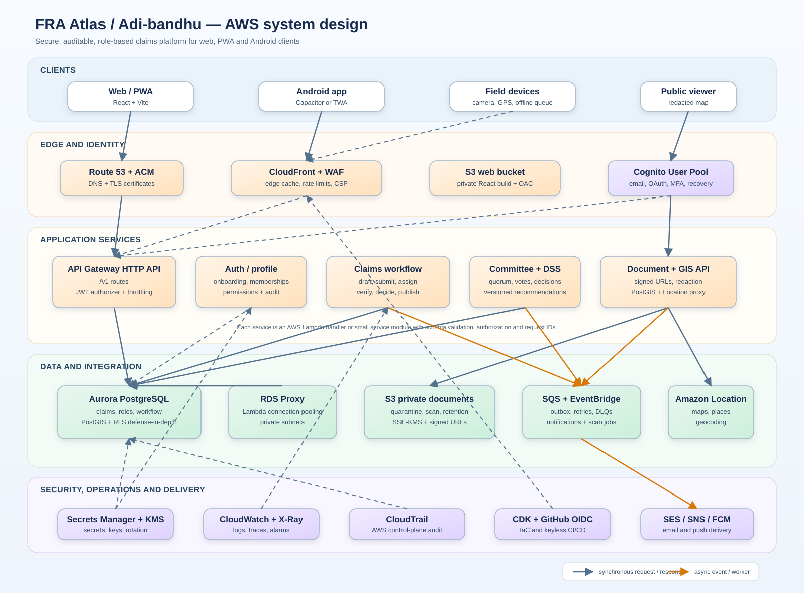

# FRA Atlas / Adi-bandhu — Whole-App AWS System Design

**Version:** 1.0  
**Date:** 2026-10-11  
**Architecture target:** production web/PWA + Android client, AWS backend, Aurora PostgreSQL/PostGIS

## System architecture image



The full-size diagram is available separately as [AWS_SYSTEM_DESIGN.svg](AWS_SYSTEM_DESIGN.svg).

## 1. Design summary

The system is split into five layers:

1. **Clients:** React/Vite web/PWA, Android shell, field devices and public viewer.
2. **Edge and identity:** Route 53, ACM, CloudFront, WAF, private S3 web hosting and Cognito.
3. **Application services:** API Gateway with Cognito JWT authorization and Lambda modules for identity, claims, committee/DSS, documents and GIS.
4. **Data and integration:** Aurora PostgreSQL/PostGIS, RDS Proxy, private S3 documents, SQS/EventBridge and Amazon Location.
5. **Security/operations:** Secrets Manager, KMS, CloudWatch, X-Ray, CloudTrail and keyless CDK/GitHub deployment.

## 2. Main request flows

### Authentication

```text
Client -> Cognito User Pool -> access token
Client -> API Gateway Authorization header
API Gateway -> JWT validation
Lambda -> profiles/memberships/permissions in Aurora
Lambda -> authorized response + audit event
```

Authentication proves who the user is. Aurora memberships and permissions decide what the user can do. Client metadata and URL parameters never grant privileges.

### Claim submission

```text
Applicant -> API Gateway -> Claims Lambda
                         -> Aurora draft/claim transaction
                         -> audit event + outbox event
Applicant -> upload-url API -> private S3 quarantine prefix
S3 event -> SQS -> document scan worker
Clean document -> private claim prefix
```

### Verification and committee decision

```text
Field officer -> assigned claim -> field visit/checklist
              -> verification_completed
Committee -> review -> quorum -> individual votes
           -> chair finalizes decision
           -> status history + immutable decision + notifications
```

### Public map

```text
Public viewer -> API -> redacted published map view
Officer        -> API -> authorized claim/geospatial data
API            -> PostGIS / Amazon Location
```

Private claim geometry and identity data are never exposed directly to the public client.

## 3. Security boundaries

- Aurora, RDS Proxy, Lambda and private document buckets run inside protected AWS networking.
- CloudFront accesses the web bucket through Origin Access Control; the bucket remains private.
- API Gateway validates Cognito JWTs before invoking protected Lambda routes.
- Lambda uses IAM roles and Secrets Manager; no AWS access key or database password is shipped to the browser or Android app.
- Aurora authorization is enforced in the API and reinforced through transaction-scoped database context/RLS where implemented.
- S3 objects are encrypted with KMS, scanned, access-logged and returned only through short-lived signed URLs.
- WAF, API throttling and Cognito protections defend public entry points.

## 4. AWS service responsibilities

| Service | Responsibility |
|---|---|
| Route 53 + ACM | DNS and TLS |
| CloudFront + WAF | static delivery, edge cache and web protection |
| S3 web bucket | React build artifacts |
| Cognito | sign-up, sign-in, OAuth, MFA and recovery |
| API Gateway | versioned HTTPS API and JWT authorizer |
| Lambda | application logic and transactions |
| Aurora PostgreSQL | system of record |
| PostGIS | claim boundaries and geospatial queries |
| RDS Proxy | Lambda connection pooling |
| S3 private bucket | claim documents and map assets |
| SQS/EventBridge | retries, outbox and asynchronous workers |
| Amazon Location | maps, places and geocoding |
| SES/SNS/FCM | notifications and push delivery |
| Secrets Manager/KMS | secrets and encryption |
| CloudWatch/X-Ray/CloudTrail | monitoring, tracing and AWS audit |
| CDK + GitHub OIDC | infrastructure and keyless deployment |

## 5. Implementation order

1. Provision AWS accounts/environments, VPC, KMS, IAM and IaC.
2. Deploy Cognito and the CloudFront/S3 web shell.
3. Deploy Aurora PostgreSQL, PostGIS, RDS Proxy and migrations from [DATABASE_DESIGN.md](DATABASE_DESIGN.md).
4. Deploy API Gateway JWT authorization and `/v1/me`.
5. Implement profiles, organizations, memberships and RLS/authorization tests.
6. Implement claims, workflow transitions, audit events and dashboard views.
7. Implement private S3 upload, malware scanning and signed downloads.
8. Implement field verification, committee voting and immutable decisions.
9. Implement DSS rules, GIS publication and Amazon Location integration.
10. Add notifications, health checks, alarms, backups and restore drills.
11. Replace frontend demo fallbacks with explicit live/offline/error states.
12. Add the Android shell and release pipeline only after the API workflows are stable.

## 6. Production gates

- No privileged role can be self-assigned.
- Every claim operation is persisted and audited.
- Invalid workflow transitions fail server-side.
- Documents are private, encrypted, scanned and access-controlled.
- Public map data is approved and redacted.
- No production screen uses hard-coded demo data as if it were live.
- CI runs tests, secret scan, dependency audit, infrastructure diff and database migration checks.
- Backup restore and incident runbooks are tested.
- Web and Android clients use the same versioned API contracts.

## 7. Related documents

- [Application documentation](APP_DOCUMENTATION.md)
- [Technical audit and Play Store readiness](TECHNICAL_AUDIT.md)
- [Whole-application database design](DATABASE_DESIGN.md)
- [AWS implementation guide](AWS_IMPLEMENTATION_GUIDE.md)

